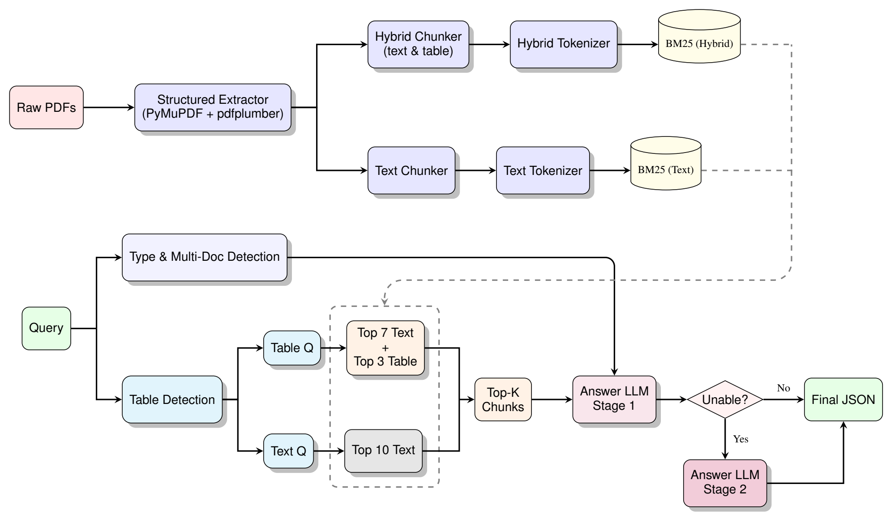
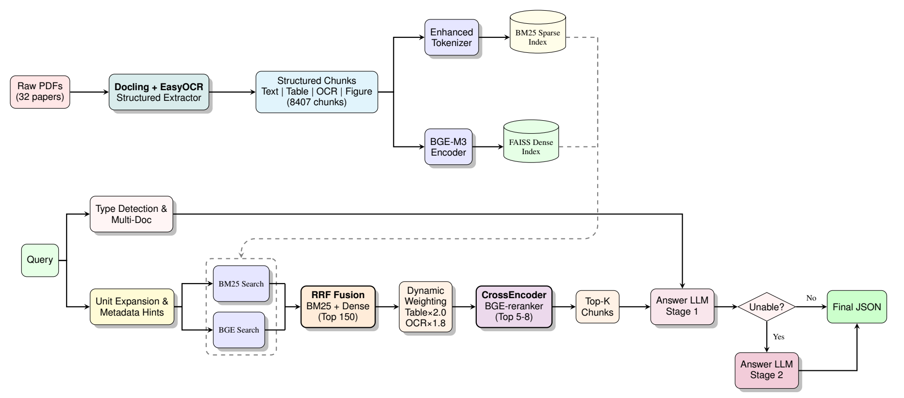

# WattBot 2025：AI 環境影響的證據檢索與問答系統

[English](README.md)

**HERO（Hybrid Evidence Retrieval Optimization）** 是 Attention Please 團隊為 WattBot 2025 與政大自然語言處理期末專題開發的 RAG 系統，從學術論文與產業報告中擷取 AI 能耗、碳排、水資源與永續相關資訊。

[技術報告](docs/WattBot2025_AttentionPlease_Technical_Report.pdf) · [專案簡報](docs/WattBot2025_AttentionPlease_Presentation.pdf) · [Baseline notebook](notebook/v1_gemini_2_5pro.ipynb) · [HERO notebook](notebook/Gemini_2_5_pro_新pipeline_0_821.ipynb)

## 中文目錄

- [專案介紹](#專案介紹)
- [技術架構](#技術架構)
- [系統架構](#系統架構)
  - [Baseline：BM25 檢索](#baselinebm25-檢索)
  - [HERO：結合視覺證據的混合檢索](#hero結合視覺證據的混合檢索)
  - [架構比較](#架構比較)
- [專案目錄](#專案目錄)
- [資料集與評分方式](#資料集與評分方式)
- [輸出格式](#輸出格式)
- [實驗成果](#實驗成果)
- [Notebook 執行設定](#notebook-執行設定)
- [團隊成員](#團隊成員)
- [相關工作](#相關工作)
- [授權](#授權)

## 專案介紹

WattBot 2025 要求系統根據技術文件，回答 AI 工作負載對環境影響的問題。答案常來自表格或圖像中的數值，並需要統一單位。

本專案收錄 Attention Please 團隊開發的兩套方法。兩者都會輸出標準化答案、文件引用與證據摘錄；來源文件不足時則回傳無法回答：

- **BM25 Baseline**：結合文字與表格檢索、問題路由，以及兩階段答案生成。
- **HERO**：加入版面解析、OCR、稀疏與稠密檢索、加權排名融合、CrossEncoder 重排序及題型專屬提示詞。

Baseline 實驗發現，直接加入 Markdown 表格會降低多項 BM25 檢索指標，但刪除表格也會失去數值證據。HERO 因此分開保存文字、表格與 OCR 區塊，並在檢索時分別設定權重。

## 技術架構

<table width="100%">
  <thead>
    <tr>
      <th width="500" align="left">項目</th>
      <th width="1500" align="left">使用技術</th>
    </tr>
  </thead>
  <tbody>
    <tr>
      <td>程式語言</td>
      <td>Python</td>
    </tr>
    <tr>
      <td>執行環境</td>
      <td>Jupyter Notebook / Google Colab</td>
    </tr>
    <tr>
      <td>Baseline 解析</td>
      <td>PyMuPDF + pdfplumber</td>
    </tr>
    <tr>
      <td>HERO 解析</td>
      <td>Docling + EasyOCR + OpenCV</td>
    </tr>
    <tr>
      <td>稀疏檢索</td>
      <td>BM25 (rank-bm25)</td>
    </tr>
    <tr>
      <td>稠密檢索</td>
      <td>Sentence-Transformers + BGE-large + FAISS</td>
    </tr>
    <tr>
      <td>重排序</td>
      <td>BGE-reranker-v2-m3</td>
    </tr>
    <tr>
      <td>答案生成</td>
      <td>Google Gemini API</td>
    </tr>
    <tr>
      <td>資料處理</td>
      <td>pandas + NumPy</td>
    </tr>
  </tbody>
</table>

上表以公開 notebook 為準；技術報告另記錄未收錄於 notebook 的實驗配置。

## 系統架構

### Baseline：BM25 檢索



*擷取自[技術報告第 5 頁 Figure 2](docs/WattBot2025_AttentionPlease_Technical_Report.pdf#page=5)。*

Baseline 包含以下五個步驟：

1. **文件擷取**：解析 PDF，整理文字與表格區塊。
2. **建立索引**：使用 BM25 進行關鍵字與數值比對。
3. **問題路由**：判斷是否為表格相關問題。Notebook 的 `hybrid_search` 對這類問題合併 **Top-7 文字 + Top-3 表格**，表格分數乘上 **0.8** 後排序；其他問題使用文字檢索。
4. **答案生成**：先以較少證據作答，無法回答時再擴大上下文。
5. **結構化輸出**：產生答案、數值、單位、引用、支持內容與解釋。

報告原圖以純文字與混合索引呈現，notebook 的路由版本則分開建立文字與表格索引。此處的 hybrid 指內容類型混合，這條 baseline 路徑尚未結合向量檢索。

### HERO：結合視覺證據的混合檢索



*擷取自[技術報告第 7 頁 Figure 4](docs/WattBot2025_AttentionPlease_Technical_Report.pdf#page=7)。*

HERO 在 Baseline 上加入五個階段：

1. **視覺證據擷取**：Docling 解析文件元素，EasyOCR 與 OpenCV 擷取圖像中的文字，保留區塊類型與文件 ID。
2. **雙路檢索**：BM25 比對精確詞彙與數值，稠密向量補足語意相近但用詞不同的證據。
3. **加權倒數排名融合**：透過 RRF 合併排名，設定**表格 ×2.0、OCR ×1.8、作者／年份匹配 ×2.0**。
4. **CrossEncoder 重排序**：聯合評估問題與候選區塊，優先保留相關證據。
5. **題型生成**：依題型選擇提示詞，先用 Top-3 上下文回答，需要第二次嘗試時再擴大傳入的證據範圍。

原圖標示的模型為 **BGE-M3**；公開 notebook 實際使用 **BGE-large-en-v1.5**、正規化向量的 FAISS `IndexFlatIP` 與 **BGE-reranker-v2-m3**，並提供 MiniLM 載入失敗備援。

### 架構比較

<table width="100%">
  <thead>
    <tr>
      <th width="500" align="left">元件</th>
      <th width="750" align="left">BM25 Baseline</th>
      <th width="750" align="left">HERO</th>
    </tr>
  </thead>
  <tbody>
    <tr>
      <td align="left">文件解析</td>
      <td align="left">PyMuPDF / pdfplumber</td>
      <td align="left">Docling + EasyOCR</td>
    </tr>
    <tr>
      <td align="left">證據來源</td>
      <td align="left">文字與表格</td>
      <td align="left">文字、表格與圖像 OCR</td>
    </tr>
    <tr>
      <td align="left">檢索方式</td>
      <td align="left">文字／表格 BM25 索引</td>
      <td align="left">BM25 + 稠密向量搜尋</td>
    </tr>
    <tr>
      <td align="left">表格處理</td>
      <td align="left">BM25 分數權重 ×0.8</td>
      <td align="left">RRF 權重 ×2.0</td>
    </tr>
    <tr>
      <td align="left">結果排序</td>
      <td align="left">加權 BM25 分數</td>
      <td align="left">加權 RRF + CrossEncoder</td>
    </tr>
    <tr>
      <td align="left">查詢調整</td>
      <td align="left">表格相關問題路由</td>
      <td align="left">單位擴展與元資料提示</td>
    </tr>
    <tr>
      <td align="left">答案生成</td>
      <td align="left">兩階段 fallback</td>
      <td align="left">題型提示詞與兩階段 fallback</td>
    </tr>
  </tbody>
</table>

## 專案目錄

```text
WattBot-RAG-System/
├── README.md
├── README.zh-TW.md
├── notebook/
│   ├── v1_gemini_2_5pro.ipynb                 # BM25 baseline experiments
│   └── Gemini_2_5_pro_新pipeline_0_821.ipynb  # HERO pipeline
├── data/
│   ├── metadata.csv                           # 32 source documents
│   ├── train_QA.csv                           # 41 training questions
│   └── test_Q.csv                             # 282 test questions
└── docs/
    ├── images/                                # Architecture figures
    ├── WattBot2025_AttentionPlease_Technical_Report.pdf
    └── WattBot2025_AttentionPlease_Presentation.pdf
```

## 資料集與評分方式

<table width="100%">
  <thead>
    <tr>
      <th width="500" align="left">檔案</th>
      <th width="750" align="left">筆數</th>
      <th width="750" align="left">內容</th>
    </tr>
  </thead>
  <tbody>
    <tr>
      <td align="left"><code>metadata.csv</code></td>
      <td align="right">32</td>
      <td align="left">文件資訊與來源網址</td>
    </tr>
    <tr>
      <td align="left"><code>train_QA.csv</code></td>
      <td align="right">41</td>
      <td align="left">問題、標準答案、引用與證據</td>
    </tr>
    <tr>
      <td align="left"><code>test_Q.csv</code></td>
      <td align="right">282</td>
      <td align="left">測試問題與預期單位</td>
    </tr>
  </tbody>
</table>

Repository 不包含原始文獻，需透過 `metadata.csv` 的網址下載；`docs/` 的 PDF 是專案報告與簡報。

<table width="100%">
  <thead>
    <tr>
      <th width="500" align="left">WattBot Score 項目</th>
      <th width="750" align="left">權重</th>
      <th width="750" align="left">評分依據</th>
    </tr>
  </thead>
  <tbody>
    <tr>
      <td align="left">答案值</td>
      <td align="right">75%</td>
      <td align="left">數值誤差或標準化類別比對</td>
    </tr>
    <tr>
      <td align="left">引用文件</td>
      <td align="right">15%</td>
      <td align="left">引用集合的 Jaccard overlap</td>
    </tr>
    <tr>
      <td align="left">無法作答判定</td>
      <td align="right">10%</td>
      <td align="left">正確辨識缺乏證據的問題</td>
    </tr>
  </tbody>
</table>

報告設定數值答案的容許相對誤差為 **±0.1%**。

## 輸出格式

生成器先產生結構化 JSON，再轉換成競賽欄位：

<table width="100%">
  <thead>
    <tr>
      <th width="1000" align="left">欄位</th>
      <th width="1000" align="left">說明</th>
    </tr>
  </thead>
  <tbody>
    <tr>
      <td align="left"><code>id</code>、<code>question</code></td>
      <td align="left">問題編號與內容</td>
    </tr>
    <tr>
      <td align="left"><code>answer</code></td>
      <td align="left">自然語言答案</td>
    </tr>
    <tr>
      <td align="left"><code>answer_value</code>、<code>answer_unit</code></td>
      <td align="left">標準化答案值與單位</td>
    </tr>
    <tr>
      <td align="left"><code>ref_id</code>、<code>ref_url</code></td>
      <td align="left">支持文件 ID 與網址</td>
    </tr>
    <tr>
      <td align="left"><code>supporting_materials</code></td>
      <td align="left">證據摘錄</td>
    </tr>
    <tr>
      <td align="left"><code>explanation</code></td>
      <td align="left">證據如何支持答案</td>
    </tr>
  </tbody>
</table>

## 實驗成果

### 競賽最終排名

<table width="100%">
  <thead><tr><th width="800" align="left">排行榜</th><th width="600" align="left">名次</th><th width="600" align="left">分數</th></tr></thead>
  <tbody>
    <tr><td>Public</td><td>第 2 名</td><td>0.886</td></tr>
    <tr><td>Private — 最終排名</td><td>第 4 名</td><td>0.840</td></tr>
  </tbody>
</table>

2026 年 10 月 14 日核對的[官方 Public 排行榜](https://www.kaggle.com/competitions/WattBot2025/leaderboard?tab=public)與[官方 Private 排行榜](https://www.kaggle.com/competitions/WattBot2025/leaderboard?tab=private)顯示，競賽已結束，**最終名次為 Private 第 4 名**。報告中的 0.886 是 Public 分數；最終 Private 分數為 0.840。兩個榜單使用 282 題測試集中的不同子集。

報告比較三組結果：加入與移除原始表格的 BM25、Baseline 與 HERO 的檢索結果，以及兩套 pipeline 搭配五種語言模型的答案分數。檢索指標使用內部問題集；模型比較使用團隊記錄的競賽分數。

### 實驗配置

報告使用三種 BM25 配置：

<table width="100%">
  <thead><tr><th width="600" align="left">配置</th><th width="1400" align="left">定義</th></tr></thead>
  <tbody>
    <tr><td>Hybrid BM25</td><td>文字加原始 Markdown 表格，用於表格悖論實驗。</td></tr>
    <tr><td>Text-Only BM25</td><td>移除表格，作為同一實驗的對照配置。</td></tr>
    <tr><td>路由式 BM25 baseline</td><td>前方架構介紹的版本：依問題混合文字／表格檢索，表格分數乘上 0.8。</td></tr>
  </tbody>
</table>

下方檢索表格重現報告 Table 1 與 Table 16；模型比較重現 Figure 5。報告與 notebook 留存輸出的差異列於本節末尾。

### 1. 表格悖論：純文字與混合 BM25 比較

Baseline 比較「文字加原始 Markdown 表格」與「純文字」兩種語料。在 **39 題**中，純文字版本的所有指標都優於或等於混合版本。

<table width="100%">
  <thead><tr>
    <th width="666" align="left">指標</th>
    <th width="666" align="left">混合：文字＋表格</th>
    <th width="666" align="left">純文字</th>
  </tr></thead>
  <tbody>
    <tr><td align="left">Recall@1</td><td align="right">79.49%</td><td align="right">87.18%</td></tr>
    <tr><td align="left">Recall@3</td><td align="right">89.74%</td><td align="right">92.31%</td></tr>
    <tr><td align="left">Recall@5</td><td align="right">92.31%</td><td align="right">92.31%</td></tr>
    <tr><td align="left">Recall@10</td><td align="right">92.31%</td><td align="right">94.87%</td></tr>
    <tr><td align="left">nDCG@1</td><td align="right">0.7949</td><td align="right">0.8718</td></tr>
    <tr><td align="left">nDCG@3</td><td align="right">0.8497</td><td align="right">0.8859</td></tr>
    <tr><td align="left">nDCG@5</td><td align="right">0.8564</td><td align="right">0.8859</td></tr>
    <tr><td align="left">nDCG@10</td><td align="right">0.8617</td><td align="right">0.8950</td></tr>
    <tr><td align="left">MRR</td><td align="right">0.8526</td><td align="right">0.8974</td></tr>
  </tbody>
</table>

來源：[報告第 4 頁 Table 1](docs/WattBot2025_AttentionPlease_Technical_Report.pdf#page=4)。這裡的 hybrid 指文字與表格混合，不是稀疏與稠密檢索。

移除原始表格後，Recall@1 提高 **7.69 個百分點**，MRR 增加 **0.0448**。報告將原因歸於表格分隔符號與破碎結構削弱 BM25 的詞彙比對。由於表格仍包含必要的數值證據，HERO 改為分開解析並加權，而不是直接刪除。

### 2. HERO 檢索品質

HERO 使用結構化擷取、稀疏與稠密檢索及重排序。下表重現報告中的檢索比較；樣本差異列於評估說明。

<table width="100%">
  <thead><tr>
    <th width="500" align="left">指標</th>
    <th width="500" align="left">Baseline</th>
    <th width="500" align="left">HERO</th>
    <th width="500" align="left">差異</th>
  </tr></thead>
  <tbody>
    <tr><td align="left">Recall@1</td><td align="right">79.49%</td><td align="right">80.49%</td><td align="right">+1.00%</td></tr>
    <tr><td align="left">Recall@3</td><td align="right">89.74%</td><td align="right">89.80%</td><td align="right">+0.06%</td></tr>
    <tr><td align="left">Recall@5</td><td align="right">92.31%</td><td align="right">92.68%</td><td align="right">+0.37%</td></tr>
    <tr><td align="left">Recall@10</td><td align="right">92.31%</td><td align="right">95.12%</td><td align="right">+2.81%</td></tr>
    <tr><td align="left">nDCG@1</td><td align="right">0.7949</td><td align="right">0.8049</td><td align="right">+0.0100</td></tr>
    <tr><td align="left">nDCG@3</td><td align="right">0.8497</td><td align="right">0.8502</td><td align="right">+0.0005</td></tr>
    <tr><td align="left">nDCG@5</td><td align="right">0.8564</td><td align="right">0.8584</td><td align="right">+0.0020</td></tr>
    <tr><td align="left">nDCG@10</td><td align="right">0.8617</td><td align="right">0.8665</td><td align="right">+0.0048</td></tr>
    <tr><td align="left">MRR</td><td align="right">0.8526</td><td align="right">0.8560</td><td align="right">+0.0034</td></tr>
  </tbody>
</table>

來源：[報告第 9 頁 Table 16](docs/WattBot2025_AttentionPlease_Technical_Report.pdf#page=9)。Recall 差異以 `%` 顯示兩個百分比直接相減的結果（百分點變化），並非相對成長率。上表忠實呈現報告值，與 notebook 留存輸出的差異另列於下方評估說明。

報告中差異最大的是 Recall@10，增加 **2.81 個百分點**；Recall@1 增加 **1.00 個百分點**，nDCG@10 增加 **0.0048**，MRR 增加 **0.0034**。Text-Only BM25 的 Recall@1 與 MRR 較高，HERO 的 Recall@10 較高；這些結果並非已驗證的同樣本比較。

### 3. 視覺證據擷取後的語料組成

報告 Table 8 列出 Docling 與 EasyOCR 產生的 **8,407 個可搜尋區塊**：

<table width="100%">
  <thead><tr>
    <th width="666" align="left">區塊類型</th>
    <th width="666" align="left">數量</th>
    <th width="666" align="left">占比</th>
  </tr></thead>
  <tbody>
    <tr><td align="left">文字</td><td align="right">7,817</td><td align="right">93.0%</td></tr>
    <tr><td align="left">表格</td><td align="right">153</td><td align="right">1.8%</td></tr>
    <tr><td align="left">圖像 OCR</td><td align="right">437</td><td align="right">5.2%</td></tr>
    <tr><td align="left">總計</td><td align="right">8,407</td><td align="right">100%</td></tr>
  </tbody>
</table>

來源：[報告第 6 頁 Table 8](docs/WattBot2025_AttentionPlease_Technical_Report.pdf#page=6)。這些數量反映可搜尋證據規模，不代表 OCR 準確率。類型標籤讓檢索階段能分別設定文字、表格與圖像文字的權重。

### 4. 不同模型與 Pipeline 比較

<table width="100%">
  <thead><tr>
    <th width="500" align="left">模型</th>
    <th width="500" align="left">BM25 Baseline</th>
    <th width="500" align="left">HERO</th>
    <th width="500" align="left">分數提升</th>
  </tr></thead>
  <tbody>
    <tr><td align="left">GPT-4o-mini</td><td align="right">0.753</td><td align="right">0.789</td><td align="right">+0.036</td></tr>
    <tr><td align="left">GPT-4o</td><td align="right">0.768</td><td align="right">0.811</td><td align="right">+0.043</td></tr>
    <tr><td align="left">GPT-5.1</td><td align="right">0.778</td><td align="right">0.807</td><td align="right">+0.029</td></tr>
    <tr><td align="left">Gemini 2.5 Pro</td><td align="right">0.807</td><td align="right">0.821</td><td align="right">+0.014</td></tr>
    <tr><td align="left">Gemini 3.0 Pro</td><td align="right">0.853</td><td align="right">0.886</td><td align="right">+0.033</td></tr>
  </tbody>
</table>

來源：[報告第 10 頁 Figure 5](docs/WattBot2025_AttentionPlease_Technical_Report.pdf#page=10)。報告記錄的五種模型分數在 HERO 欄位都較高；此表與上方最終 Private 排名分開呈現。

差異最大的是 **GPT-4o 的 +0.043**。**Gemini 3.0 Pro 的報告分數最高，為 0.886**，與 Public 榜單分數相同。公開 HERO notebook 初始化的是 Gemini 2.5 Pro；其報告分數由 0.807 變為 0.821。

### 5. 限制與未來工作

HERO 的融合權重與問題路由仍是啟發式規則；上述實驗也沒有將兩階段生成的效果與檢索改動分開測量。報告提出的後續方向包括**學習式融合權重**、**多語言語料**與**大型文件集合的階層索引**。

<details>
<summary>評估範圍與重現細節</summary>

Baseline 表格實驗使用 39 題；HERO 最後留存的評估使用 41 題，包含不可回答問題。其輸出記錄 Recall@3 為 87.80%、nDCG@3 為 0.8384、MRR 為 0.8519，與報告 Table 16 不同。因此報告比較應視為文件記錄的結果，而非本次驗證的同樣本實驗；純文字 baseline 在部分指標上也高於上述 HERO 數值。

Notebook 的 Recall@K 判斷前 K 個結果是否命中任一標準引用，實際上是命中率。多個區塊可來自同一文件，區塊排名與去重文件排名不能混用。留存評估也包含不可回答問題，會影響指標解讀。

公開 HERO 檢索預設保留八個最終區塊；生成器要求十個 fallback 區塊時，仍只能使用實際傳入的內容。目前所有問題均啟用重排序，拒答由規則與 LLM 回應決定，不是校準後的信心估計。本節數據來自報告與留存輸出，沒有重新執行模型或競賽評分。

</details>

## Notebook 執行設定

以下依公開程式整理，**尚未從乾淨環境驗證完整執行成功**。Notebook 保留實驗 cell，需要手動設定。

### HERO Notebook

1. 在 Google Colab 開啟 [HERO notebook](notebook/Gemini_2_5_pro_新pipeline_0_821.ipynb)，將 `data/` 的三份 CSV 上傳到 `/content/`。
2. 安裝流程使用的套件。尚未驗證版本相容性，執行前請先檢查 notebook 既有的安裝 cell：

```python
%pip install docling easyocr opencv-python-headless rank-bm25 sentence-transformers faiss-cpu pandas numpy requests pdfminer.six pillow tqdm google-genai
```

3. 在 Gemini 生成 cell 中，替換原本的佔位金鑰與 client 初始化。若使用 Colab Secrets，建立 `GOOGLE_API_KEY` 並允許 notebook 存取，再使用：

```python
from google.colab import userdata
from google import genai

client = genai.Client(api_key=userdata.get("GOOGLE_API_KEY"))
```

4. 依序執行：CSV 載入 → PDF 下載 → EasyOCR 初始化 → Docling／OCR 處理 → BM25／向量索引 → 檢索與重排序函式 → Gemini 生成與匯出。評估與清除快取 cell 為選用步驟。

程式使用的路徑如下：

```text
/content/metadata.csv
/content/train_QA.csv
/content/test_Q.csv
/content/papers/
/content/wattbot_working/chunks/structured_chunks_with_ocr.jsonl
/content/submission_enhanced.csv
```

生成答案前，請檢查文件下載失敗清單與 OCR 區塊數。完整執行還需要相容的 Docling 圖像物件、模型下載、API 存取與原始文獻。

### Baseline Notebook

[Baseline notebook](notebook/v1_gemini_2_5pro.ipynb) 收錄了多組實驗。若要準備資料並執行其中的 Gemini 答案生成程式，請依序檢查：

1. 在 Google Colab 開啟 notebook，執行 Kaggle 登入、安裝套件與下載競賽資料的程式格。你需要有 WattBot 2025 競賽資料的存取權。下載時會印出 `Downloaded to: ...`，請記下這個資料夾位置。
2. 後面的程式有幾處把資料夾寫死為 `/root/.cache/kagglehub/competitions/WattBot2025`。請改成第 1 步印出的實際位置，尤其是讀取資料的 `INPUT_DIR`，以及最後 `main()` 裡的 `INPUT_DIR`。PDF 解析測試的 `data_dir` 也使用同一個寫死的路徑。
3. 執行產生 `/content/hybrid_chunks.json` 所需的文件處理程式格。最後的答案生成程式會讀取這個檔案，以及 `INPUT_DIR` 中的 `metadata.csv` 和 `test_Q.csv`；執行前先確認三個檔案都存在。
4. 執行最後的答案生成程式格之前，先確認已安裝 `google-genai`；notebook 會匯入它，但沒有對應的安裝程式格。將 `GEMINI_API_KEY = "# ⚠️ 請替換成你的 API Key"` 這行的佔位文字換成有效金鑰，再執行該格產生提交用 CSV。這格會自動呼叫 `main()`，並將測試題送到 Gemini API。分享 notebook 前，請移除金鑰。

Notebook 另有 PDF 解析與檢索測試，不屬於最後答案生成函式。設定 cell 會安裝 Python 套件、Poppler 與 Tesseract；尚未從乾淨環境驗證完整流程。

## 團隊成員

**Team Attention Please**

- **Shao-Hua Wu** - 國立政治大學金融學系
- **Pei-Ju Hsieh** - 國立政治大學金融學系
- **Bo-Hao Chen** - 國立政治大學金融學系
- **Yi-Chen Hsiao** - 國立政治大學財政學系
- **Yi-Yang Xue** - 國立政治大學資訊科學系

## 相關工作

[技術報告](docs/WattBot2025_AttentionPlease_Technical_Report.pdf)包含文獻回顧與 KohakuRAG 案例。

## 授權

目前 repo 未包含 `LICENSE` 檔案，尚未在 repository 中明定授權條款。

[English](README.md) · [回到中文目錄](#中文目錄)
